<p align="center">
  <picture>
    <source media="(prefers-color-scheme: dark)" srcset="Branding/GlitterLive-Logo-Horizontal-Dark-Transparent.png">
    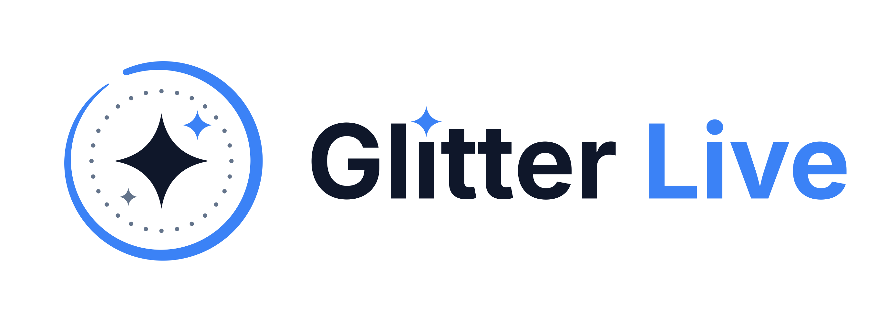
  </picture>
</p>

<p align="center">
  Turn any video into a Live Photo wallpaper that moves every time you wake your iPhone.
</p>

<p align="center">
  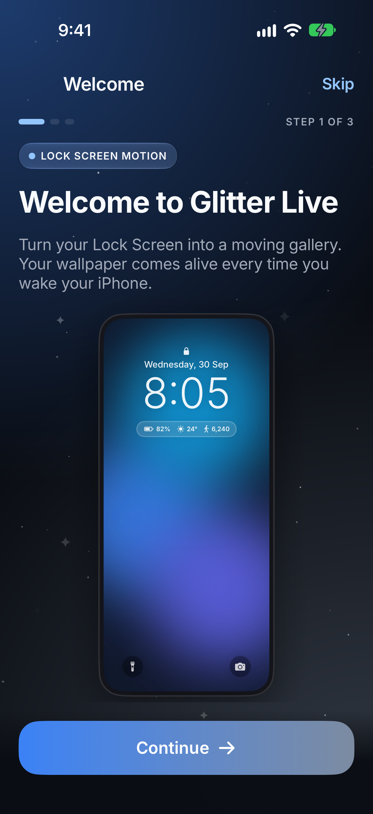
  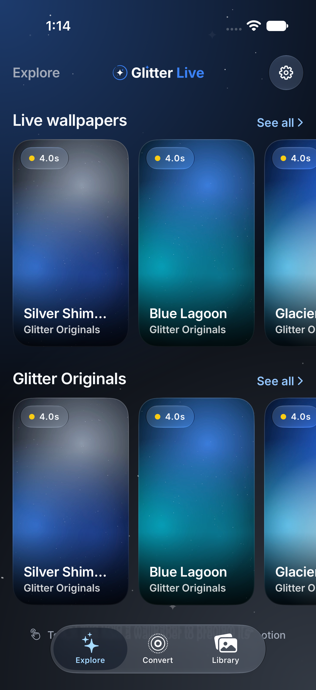
  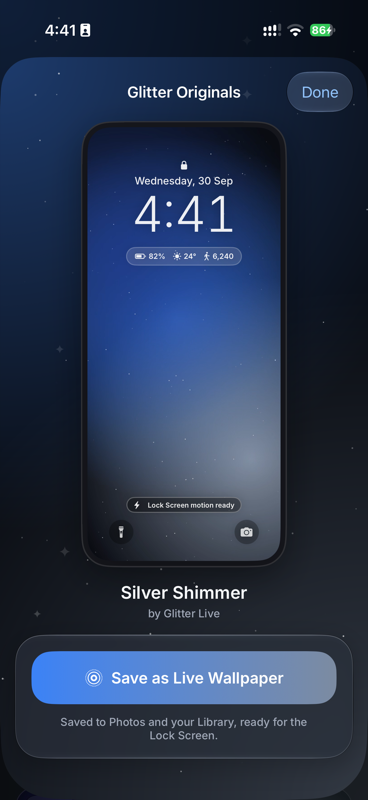
  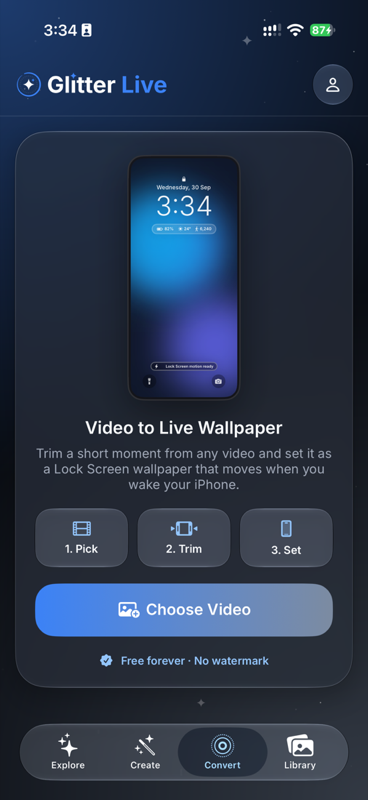
</p>
<p align="center">
  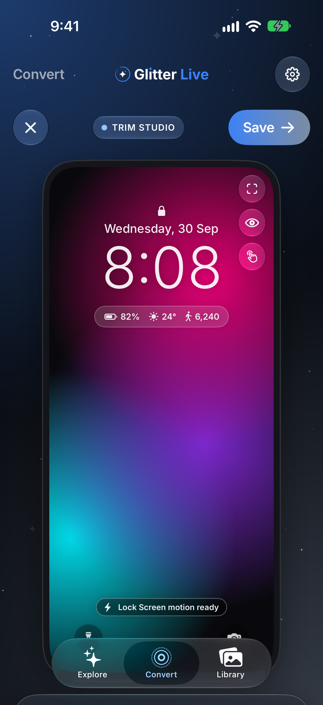
  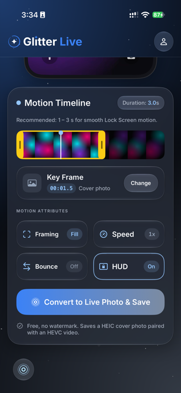
  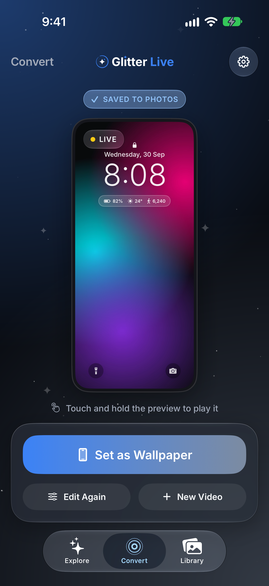
  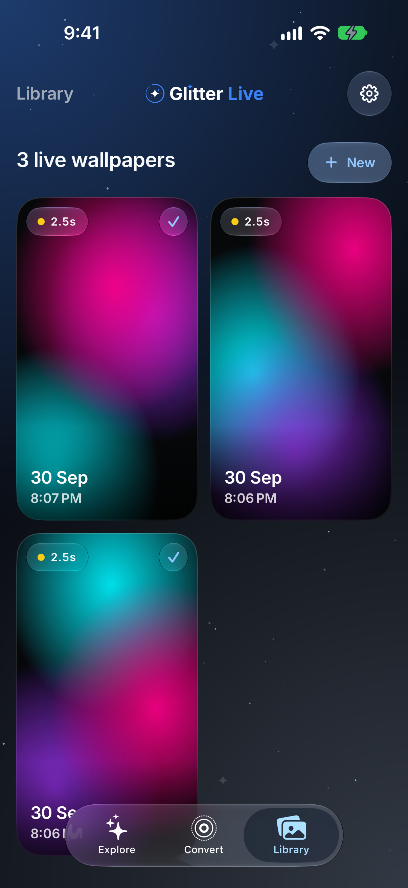
</p>

<details>
<summary>Light mode</summary>
<p align="center">
  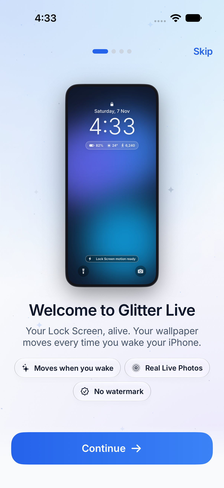
  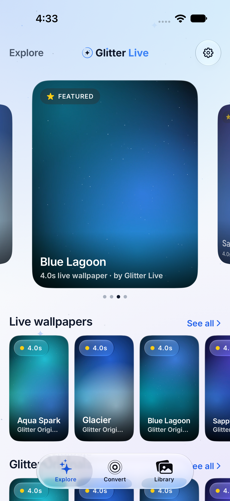
  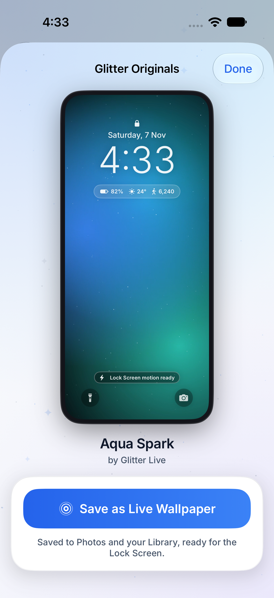
  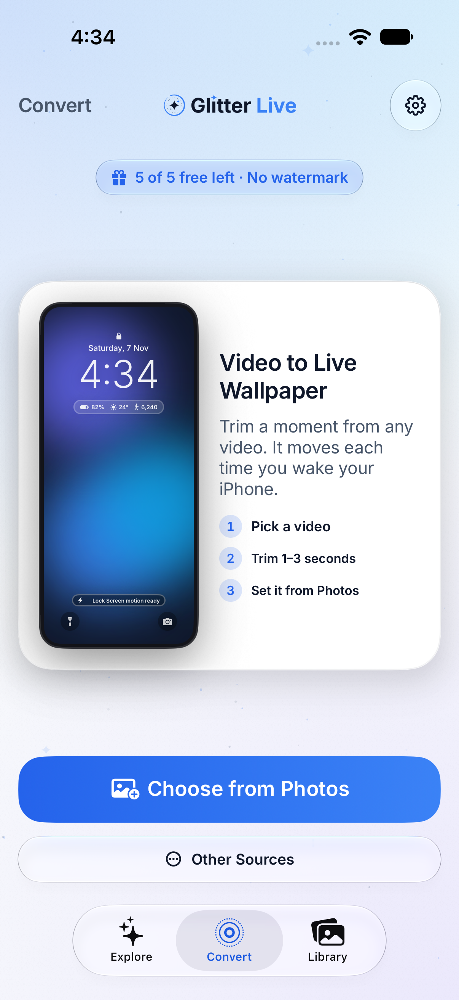
</p>
<p align="center">
  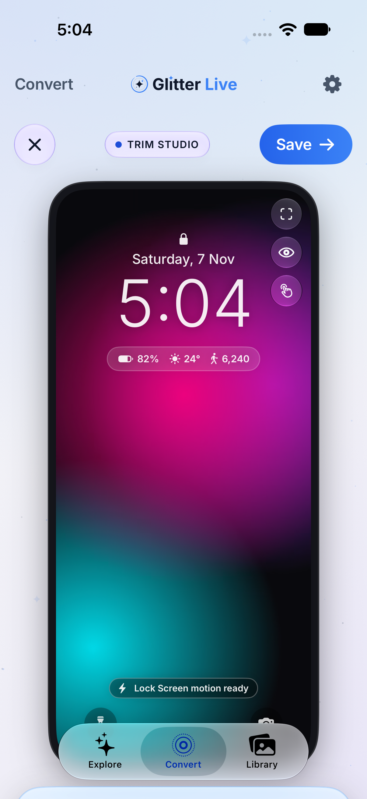
  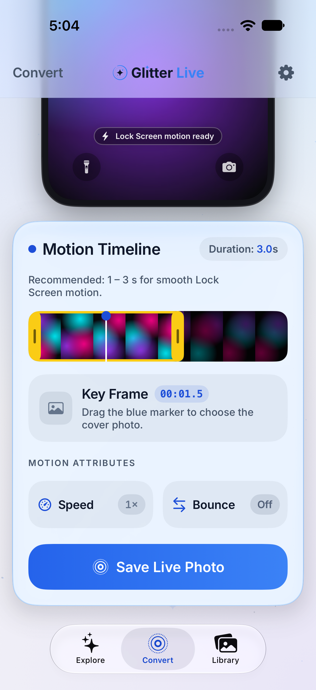
  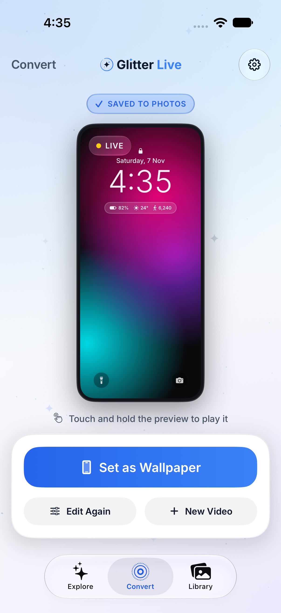
  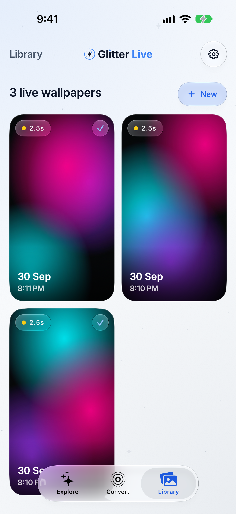
</p>
</details>

## Features

- **Explore**: the first tab, a curated catalog of live and still wallpapers, served from Supabase.
  - A Featured carousel keeps the middle card in view, slides like an album shelf and loops on its own.
  - Below it, a Categories grid opens every wallpaper in a category, dealt in like a shuffled deck.
  - Saving puts a Lock Screen-ready Live Photo (or a still) in Photos in one tap.
  - Touching and holding a live wallpaper previews its motion.
  - While the catalog loads, shimmering placeholders hold the page's shape.
- **Create**: describe a scene, or tap Surprise Me, pick a style, and get an AI wallpaper image.
  - Save it as a still, or add depth-parallax motion on the phone to make it a Live wallpaper.
  - Each image unlocks with a short rewarded ad, up to 3 a day per install.
  - Prompts and images are checked by safety filters, and any image can be reported.
- **Video to Live Wallpaper**: pick any video, trim a 1–3 second moment, and save it as a Live Photo that plays on the Lock Screen when the iPhone wakes. Videos can come from Photos, Files, a direct link (Dropbox and Google Drive share links work), or Share → Glitter Live from another app.
- **Trim Studio**: filmstrip with trim handles that preview the frame under your finger and stretch softly at their limits, a draggable cover-frame marker, pinch-and-drag framing inside a Lock Screen preview (clock, widgets and quick actions) that springs back with your finger's momentum, 0.5×–2× speed and a forward-and-back bounce.
- **Sharp cover photo**: the still shown while the phone is locked is rendered from the original video at up to 1320 px wide, sharper than the motion clip.
- **Library**: every wallpaper is kept in the app, so it can be previewed, saved to Photos again or deleted.
  - It shows as a list or a grid, filtered to All, Live or Stills.
  - Each wallpaper shows whether it's already in Photos.
  - Swipe to delete one, or select several and delete them together.
- **Private by design**: videos are processed on the device, and the app only asks to *add* photos, never reading the library.
  - Create sends only the scene description and style to the server, with a random install ID used to enforce the daily limit.
  - Google's ad SDK collects what it needs when someone chooses to watch an ad (see [privacy](docs/privacy.md)).
- **Silver Shimmer design**: light and dark modes that follow the system, an obsidian dark mode lit by brand blue and silver, softly twinkling glitter, and native Liquid Glass on iOS 26+ with frosted fallbacks on iOS 17–25. A logo reveal plays as the app launches.
- **Accessible**: Dynamic Type with size-tuned letter-spacing, Reduce Motion, Increase Contrast and Reduce Transparency are all supported.
- **Free to try**: never a watermark.
  - Explore is free.
  - The first 5 conversions are free. After that, each conversion is free with a rewarded ad, or a one-time Unlimited Conversions purchase removes the limit and the ads.
  - Create unlocks each image with a short rewarded ad.

## Lock Screen motion

Photos accepts any still and movie that share a content identifier as a Live Photo. The Lock Screen's wallpaper editor is stricter, and reports *"Motion Not Available"* unless the movie meets extra, undocumented requirements. Glitter Live writes:

- 8-bit HEVC video with the long side at most 1920 px and a duration of 5 s or less
- a `live-photo-info` timed-metadata track, one sample per frame
- a `still-image-time` + `live-photo-still-image-transform` sample at the cover frame, in the 600 timescale and never at 0 s
- a cover photo that shows the same frame as the movie (it may be larger)

See [`LivePhotoBuilder.swift`](LiveWall/Core/LivePhoto/LivePhotoBuilder.swift) and [`LivePhotoMetadata.swift`](LiveWall/Core/LivePhoto/LivePhotoMetadata.swift).

## Catalog backend

Explore reads the `catalog` view, which has the published live and still wallpapers. It downloads files from a public Supabase Storage bucket.
- Version 1.0 still reads the `wallpapers` table directly, and sees only live rows.
- Both are read-only for the app's publishable key.

Wallpapers are added, edited, reordered and published in the admin site, which lives in the private `glitter-live-admin` repository. Its database schema lives here.

The upload script still works for live wallpapers:

```bash
cp scripts/storage.env.example scripts/storage.env   # fill in the S3 and secret keys; this file is git-ignored
scripts/upload-wallpaper.sh ~/Movies/loop.mp4 --title "Neon Rain" --category "Abstract" --creator "Your Name"
```

Database migrations live in [`supabase/migrations`](supabase/migrations):
- `0001` is the wallpapers table.
- `0002` adds admin access and still wallpapers.
- `0003` adds Create's generation limits.

Create's server is two edge functions in [`supabase/functions`](supabase/functions):
- `generate` checks the prompt, then generates the image with FLUX.1 schnell on Cloudflare Workers AI.
- `ad-reward` receives AdMob's server-side verification callback.

See [docs/create-plan.md](docs/create-plan.md).

## Requirements

- iOS 17 or later (Lock Screen Live Photo motion needs iOS 17+)
- Xcode 26 or later
- [XcodeGen](https://github.com/yonaskolb/XcodeGen)

## Getting started

```bash
brew install xcodegen
./scripts/fetch-depth-model.sh
xcodegen generate
open LiveWall.xcodeproj
```

`fetch-depth-model.sh` downloads Apple's Core ML Depth Anything V2 (about 19 MB), which Create uses for parallax motion. Without it the app still builds and falls back to a plain push-in. Building the parallax kernel needs Xcode's Metal Toolchain (`xcodebuild -downloadComponent MetalToolchain`).

Set your own development team in `project.yml` (`DEVELOPMENT_TEAM`), or under Signing & Capabilities in Xcode, then run on an iPhone. The Simulator can't show Lock Screen wallpapers, so test motion on a real device.

Release builds read the real AdMob IDs from `Config/AdMob.secrets.xcconfig`, which isn't committed. Without it they still build, with Google's sample IDs, and show no ads; debug builds always use the samples.

## Tests

```bash
xcodebuild test -project LiveWall.xcodeproj -scheme LiveWall \
  -destination 'platform=iOS,name=<your iPhone>' -only-testing:LiveWallTests
```

- `LiveWallTests`: Live Photo pairing, required metadata tracks, output size and length, speed and bounce, cover-photo resolution and frame match, and the Library.
- `LiveWallUITests`:
  - `ScreenshotTests` launches each screen with demo content (`-demoVideo`, `-demoResult`, `-demoLibrary`) and attaches screenshots to the test result.
  - `TabRoundTripTests` replays reopening the intro from Settings, leaving it from each page and switching tabs straight away. That path once crashed iOS 27's glass renderer.

## CI and deployment

| Workflow | Runs on | Does |
| --- | --- | --- |
| [Deploy Supabase functions](.github/workflows/deploy-functions.yml) | pushes to `main` that change `supabase/functions/`, or by hand | deploys `generate` and `ad-reward`; needs the `SUPABASE_ACCESS_TOKEN` repository secret |
| [Version bump](.github/workflows/version-bump.yml) | pull requests from `dev` into `main` | sets `MARKETING_VERSION` on `dev` to the next minor version, or patch / major with a `release: patch` / `release: major` label |
| [Release](.github/workflows/release.yml) | pushes to `main` that change `project.yml`, or by hand | when `MARKETING_VERSION` is new, tags it `vX.Y.Z` and creates a GitHub release with notes from the merged pull requests |
| Xcode Cloud | every push to `main` | archives and uploads to TestFlight; [`ci_scripts/ci_post_clone.sh`](ci_scripts/ci_post_clone.sh) generates the project, fetches the depth model and writes the AdMob IDs from the `GAD_APPLICATION_ID` and `GAD_REWARDED_AD_UNIT_ID` secret environment variables |

Database migrations aren't deployed automatically; run `supabase db push` after reviewing them.

### Releasing

`main` only receives releases, because every push to `main` makes an Xcode Cloud TestFlight build.

**Branches**
- `dev` is where work goes. Branch from it, and open pull requests into it.
- `main` changes only through a release pull request from `dev`.

**Versions**
- The App Store version is `MARKETING_VERSION` in [`project.yml`](project.yml). Xcode Cloud sets the build number.
- Bump the patch (1.1.1 → 1.1.2) for fixes and the minor (1.1.x → 1.2.0) for features.
- A version with a suffix, such as `1.2.0-beta.1`, becomes a GitHub pre-release.

#### 1. Get `dev` ready
- Merge every pull request meant for the release into `dev`.
- Run the tests (see [Tests](#tests)).
- Check a device build of `dev`, especially Liquid Glass screens: some glass bugs only show on hardware.

#### 2. Open the release pull request
Open a pull request from `dev` into `main`. To bump anything other than the minor version, add the label as you open it:

```bash
gh pr create --base main --head dev --label "release: patch" --title "Release X.Y.Z"
```

| Label | Bump |
| --- | --- |
| none | minor: 1.1.2 → 1.2.0 |
| `release: patch` | patch: 1.1.2 → 1.1.3 |
| `release: major` | major: 1.1.2 → 2.0.0 |

[Version bump](.github/workflows/version-bump.yml) then commits `Version X.Y.Z` to `dev`, so the pull request carries the new version.
- It always computes the version from `main`'s, so changing the label or running it again is safe.
- The run started by its own commit may show **action required** in Actions. That run has nothing left to do, and the version commit is already on `dev`.

#### 3. Merge
Merge with a **merge commit**, not squash, so `dev` and `main` keep the same history. Then:
- [Release](.github/workflows/release.yml) tags the merge `vX.Y.Z` and creates a GitHub release with notes from the merged pull requests.
- Xcode Cloud archives `main` and uploads the build to TestFlight.
- If the release touches `supabase/functions/`, [Deploy Supabase functions](.github/workflows/deploy-functions.yml) deploys them.
- Database migrations are not deployed for you: review them, then run `supabase db push`.

#### 4. App Store Connect
1. Create the version `X.Y.Z`.
   - If an earlier version was never submitted, change its number instead: its notes and screenshots stay.
2. Fill in What's New, then update screenshots, App Privacy and review notes if the release changes them (see [docs/app-store.md](docs/app-store.md)).
3. Once the TestFlight build has processed, test it on a device.
4. Choose the build for the version, then **Add for Review**.

#### Fixing a release that hasn't shipped
Fix it the same way:
- Open a pull request into `dev`.
- Open a new `dev` → `main` pull request with `release: patch`.
- Choose the new build for the version in App Store Connect, renaming the version to match.

## Project structure

```
LiveWall/
  App/            App entry point, tab bar and launch intro
  Core/Ads/       Rewarded ads and consent
  Core/Catalog/   Supabase catalog client and downloads
  Core/Generation/ Create's server client and daily allowance
  Core/Import/    Videos from links and the share extension
  Core/LivePhoto/ Video → Live Photo pipeline, saving and preview
  Core/Store/     Unlimited Conversions purchase and free allowance
  DesignSystem/   Colors, type, glass components, motion, logo artwork, Lock Screen overlay
  Features/       Explore, Create, Convert, Library, Onboarding, Settings
  Resources/      Assets, fonts, privacy manifest
LiveWallShare/    Share extension
LiveWallTests/    Unit tests
LiveWallUITests/  Screenshot and tab round-trip UI tests
Branding/         Logo files, layered SVGs and the Jitter logo reveal
docs/             Privacy policy, support page, App Store listing, Create plan, screenshots
scripts/          Icon, logo, store-asset and SVG renderer, wallpaper upload tools
supabase/         Database migrations and edge functions
```

## Roadmap

### Released

- **1.0** (on the App Store since 6 November 2026):
  - Video to Live Wallpaper with Trim Studio, Library and Explore.
  - Fluid-interface design pass, accessibility support and the launch logo reveal.
- **1.1**:
  - Create (AI wallpapers, one rewarded ad per image) and still wallpapers in Explore.
  - Explore redesign: Featured carousel and Categories grid.
  - Library list and grid, filters and multi-delete.
  - Light mode redesign and the catalog admin site.
- **1.1.2**: fixes for a Liquid Glass crash and a grey flash after replaying the intro.

### Next

- **Glitter Live Pro**: a subscription for more Create generations without ads (see [the plan](docs/create-plan.md)). Explore stays free with no ads.
- **AI video motion**: the server can already turn an image into video with LTX-Video. The app still uses on-device depth parallax.
- **Explore extras**: search, sort by New, and later like counts (likes need backend support).
- **Trim Studio**: video stabilization.
- **Screenshots**: add Create to the README screenshots.

## Acknowledgements

- [LivePaper](https://github.com/Yuyang16Z/LivePaper) (MIT) for documenting the Lock Screen's Live Photo requirements. See [THIRD_PARTY_NOTICES.md](THIRD_PARTY_NOTICES.md).
- [Inter](https://rsms.me/inter/) typeface (SIL Open Font License).
- [Depth Anything V2](https://github.com/DepthAnything/Depth-Anything-V2) Small, in [Apple's Core ML conversion](https://huggingface.co/apple/coreml-depth-anything-v2-small) (Apache-2.0), for Create's parallax motion.

## License

Glitter Live is released under the [MIT License](LICENSE). The bundled Inter font files keep their own SIL Open Font License, and third-party notices are in [THIRD_PARTY_NOTICES.md](THIRD_PARTY_NOTICES.md).
